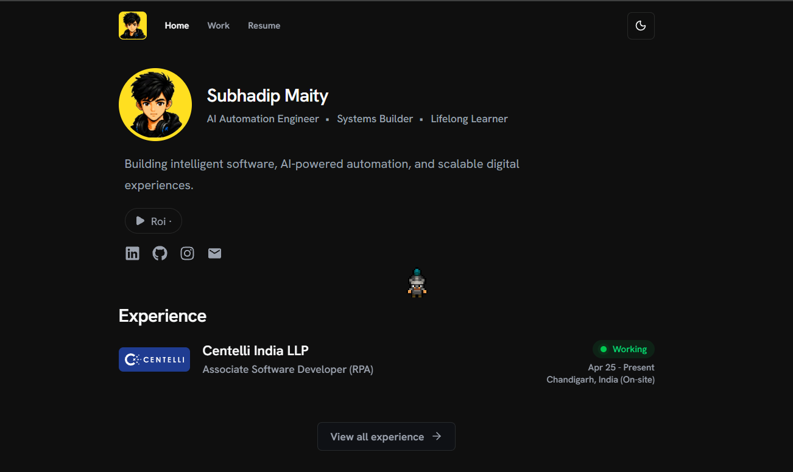

# SontuCode — Developer Portfolio

A modern, responsive developer portfolio showcasing my **projects, experience, skills, certifications, and professional journey** in software development, RPA, and AI-driven automation.

<p align="center">
  <a href="https://sontucode.dev">
    
  </a>
</p>

<p align="center">
  <strong>Building software, automating workflows, and exploring intelligent systems.</strong>
</p>

<p align="center">
  A personal developer portfolio showcasing my experience, projects, technical skills, certifications, and journey in software engineering.
</p>

**[Live Website](https://sontucode.dev)**

## About

I'm a developer passionate about building practical solutions, automating workflows, and exploring modern technologies.

This portfolio reflects my work in **UiPath, Playwright, TypeScript, full-stack development, and agentic automation**, with a focus on clean design, performance, and maintainable code.

## Tech Stack

- **Framework:** Next.js (App Router), React
- **Language:** TypeScript
- **Styling:** Tailwind CSS, shadcn/ui
- **Icons:** Lucide React
- **Deployment:** Vercel
- **SEO:** Metadata API, Sitemap, Open Graph, JSON-LD

## Features

- Responsive and modern UI
- Interactive hero and smooth animations
- Projects showcase with detailed case studies
- Professional experience and technical skills
- Certifications and recommendations
- SEO optimization and social sharing previews
- Reusable components and scalable architecture

## Getting Started

Clone the repository and install dependencies:

```bash
git clone https://github.com/SontuCoder/sonx-portfolio.git
cd sonx-portfolio
bun install
```

Start the development server:

```bash
bun dev
```

Open **http://localhost:3000** in your browser.

Build for production:

```bash
npm run build
npm run start
```

## Deployment

Deployed on **Vercel** with automatic deployments through GitHub.

**Production:** https://sontucode.dev

## Project Goals

- Build a clean, accessible, and performant portfolio.
- Showcase real-world projects and engineering experience.
- Maintain a reusable and scalable codebase.
- Continuously improve the developer and user experience.

## Contact

Feel free to explore my work or connect with me through my [portfolio](https://sontucode.dev).

---

<p align="center">
  Built with Next.js, TypeScript & Tailwind CSS.
</p>
